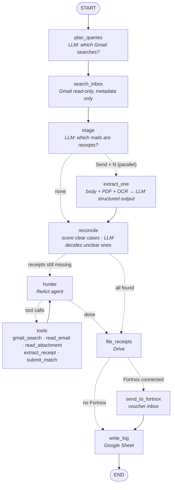

# invoice_audit — AI receipt matching agent

A LangGraph agent that reads a Gmail inbox (read-only), finds receipts and invoices in **any language and any
country**, matches them to a card statement (Mynt, Pleo, any bank export), files them in Google Drive and keeps a
Google Sheet log, and sends matched receipts to the Fortnox inbox. The owner only handles the few misses, in one
tap each.

## The agent



| Node | What it does | Model |
|---|---|---|
| `plan_queries` | Turns noisy card descriptors (`UBER *TRIP`, `BOLT.EU/O/2610`) into Gmail queries per brand/sender domain | gpt-oss-20b |
| `search_inbox` | One structural scan of the date window (operators only) + the planned searches. Metadata only | – |
| `triage` | Picks likely receipts/invoices from `n\|sender\|subject` lines, in any language | gpt-oss-20b |
| `extract_one` | Fan-out with `Send`: reads body, PDF text (pypdfium2) or scans/photos (vision OCR) → strict JSON schema: merchant, date, total, currency, tax (VAT/moms/GST…), seller tax id, doc no | gpt-oss-20b, qwen3.8 vision |
| `reconcile` | Cheap score (amount › date › name, also original FX amount) auto-matches clear cases; the LLM judges ambiguous ones like an accountant (tips, FX, early bookings) and must give a reason | gpt-oss-120b |
| `hunter` ⇄ `tools` | ReAct agent with tools, only for what is still missing: thinks where the receipt could be, searches, opens mails/attachments, extracts, `submit_match` updates graph state via `Command` | gpt-oss-120b |
| `file_receipts` | `Receipts/<year>/<year-month>/<date> <merchant> <amount>.pdf` in Drive | – |
| `send_to_fortnox` | Matched receipts to the Fortnox voucher inbox (`Inbox_v`), once each; suggestions wait for the owner | – |
| `write_log` | Google Sheet: every transaction with status, reason, receipt, Drive link, Fortnox status | – |

State is a typed `StateGraph` (`AuditState`) with reducers (`merge` dicts for receipts/matches, `add_messages` for
the hunter, `operator.add` for the progress log). Google credentials and models are passed as runtime `context`,
never stored in state.

**No hardcoded keywords, column names, currencies or countries.** Prompts ([prompts.py](prompts.py)) tell the
model to handle any language, currency and tax system; tested on Swedish kvitto, Indian GST tax invoice, Hindi
receipt, German Rechnung, English receipts, a Mynt export and an HDFC (India) statement with a `Cr/Dr` column.

## Built for the Groq free tier

Free tier per model: **30 req/min, 8K tokens/min, 200K tokens/day**. The agent is designed around it:

- **Short prompts** (~60–100 tokens each) and strict JSON schemas instead of long instructions.
- **Compact inputs**: emails are cut to the opening lines + every line containing a digit (amounts, dates, tax, ids
  — true in every language), URLs removed, max ~1.8K chars. Triage sends `n|sender|subject` and gets numbers back.
- **Two models**: limits are per model, so bulk reading runs on `gpt-oss-20b` and reasoning on `gpt-oss-120b`.
- **Client-side limiter** (`RateBudget`): waits before a call instead of getting 429s. `reasoning_effort="low"`
  keeps hidden reasoning tokens small. Each run logs its token use.
- **Bounded hunter**: max 5 transactions, 6 steps, compact tool outputs.

Measured: a month with 11 transactions and 11 emails → **≈18K tokens, ~75 s** (≈9% of one model's daily budget).

## Try it

Open the app → **Try with sample data** → **Use sample Mynt export** → **Run agent now**.
With a real inbox: **Sign in with Google** → drop your statement → **Run agent now**.

Nightly mode (same graph, no UI), e.g. cron `0 3 * * *`:

```bash
python agent.py path/to/statement.csv 1     # 1 = look back one day
```

## Files

| File | What it does |
|---|---|
| [agent.py](agent.py) | LangGraph `StateGraph`: state, nodes, routing, reconcile logic, statement reader, `run()`, CLI |
| [tools.py](tools.py) | Agent tools (`@tool` + `ToolRuntime`), Gmail read-only, PDF/vision reading, Drive + Sheet, rate limiter |
| [prompts.py](prompts.py) | All LLM instructions (short, language-agnostic) |
| [app.py](app.py) | Streamlit UI: 3-step onboarding, home screen, one-tap fixes, Swedish/English, live agent log |
| [fortnox.py](fortnox.py) | Fortnox OAuth2 + upload to the voucher inbox; `python fortnox.py` connects the nightly job |
| [demo_inbox.py](demo_inbox.py) | Demo receipt emails for the sample statement (`--check` tests them, `--send` mails them) |
| [sample_mynt_export.csv](sample_mynt_export.csv) | Sample statement in Mynt style (`;`, `1 450,00`, original currency) |

## Run locally

```bash
python -m venv .venv && source .venv/bin/activate
pip install -r requirements.txt
cp .env.example .env        # fill in the keys
streamlit run app.py
```

## Setup (one time)

1. **Groq** – API key at console.groq.com → `GROQ_API_KEY`.
2. **Google Cloud** (console.cloud.google.com), new project:
   - Enable **Gmail API**, **Google Drive API**, **Google Sheets API**.
   - *OAuth consent screen*: External, app name `invoice_audit`, scopes `gmail.readonly` + `drive.file`,
     add every tester's Gmail under **Test users**.
   - *Credentials → OAuth client ID → Web application*, redirect URIs `http://localhost:8501` and the deployed URL.
   - Put client ID/secret in `GOOGLE_CLIENT_ID`, `GOOGLE_CLIENT_SECRET`, and set `REDIRECT_URI`.
   - *Audience → Publish app* ("In production") so any Google account can sign in. Until the app is verified,
     people see "Google hasn't verified this app" (Advanced → continue) and the project is capped at 100 users.
     In "Testing" only listed test users can sign in ("Access blocked") and tokens expire after 7 days.
3. **Fortnox** (optional) – Developer Portal → *My Integrations → Create new integration*, scopes `inbox`,
   `archive`, `connectfile`, redirect URI = `REDIRECT_URI`. Test against a sandbox (*My sandboxes*). Put the keys in
   `FORTNOX_CLIENT_ID`, `FORTNOX_CLIENT_SECRET`. Each customer needs a Fortnox integration licence.
4. **Deploy** on Render with [render.yaml](render.yaml) (*New → Blueprint*): a Python web service for the app
   (`receipt-audit.onrender.com`) and a static site for the home page, privacy policy and terms
   (`receipt-audit-site.onrender.com`, from [site/](site/)), which Google's OAuth branding page asks for.
   Add the app URL as a redirect URI in Google Cloud. Streamlit Community Cloud also works (keys under *Secrets*);
   serverless hosts like Vercel can't run a long-lived Streamlit server.

## Design decisions

- **Onboarding in 3 taps**: Google sign-in (one consent covers Gmail + Drive) → drop any statement → run.
  No provider picker: the LLM reads any export layout (CSV, Excel, PDF).
- **Least privilege**: `gmail.readonly` (cannot send/change/delete) and `drive.file` (only files the app created).
- **Store as little email as possible**: state holds extracted fields + message ids only. The original document is
  re-fetched from Gmail at filing time and goes straight into the owner's own Drive.
- **Honest matching**: every match has a confidence, a reason and who decided (`rules`, `LLM`, `hunter agent`,
  `owner`). Unsure → "Is this it?" suggestion, never a silent guess. One receipt per transaction.
- **Exceptions in one tap**: confirm the suggestion, snap a photo (camera on mobile, filed in Drive), or mark
  "no receipt". The Sheet updates immediately.
- **GDPR**: "Disconnect & delete my data" revokes the Google token; nothing is stored server-side.

## Biggest risks

1. **Gmail access** – `gmail.readonly` is a *restricted* scope: production needs Google verification plus an annual
   CASA security assessment; until then max 100 test users and an "unverified app" screen. Start in week 1.
   Microsoft (`Mail.Read`) needs publisher verification and often tenant admin consent.
2. **LLM data location** – Groq is US-hosted; production under GDPR needs EU processing (e.g. Claude on AWS
   Bedrock Frankfurt, Azure OpenAI EU, Mistral). The graph only depends on a LangChain chat model, so it's a swap.
3. **Fortnox** – each customer needs an integration licence and the app needs Fortnox approval. Mynt/Fortnox
   Företagskort already match receipts for their own card: our edge must be *all cards + all inboxes + one screen*.
4. **Free-tier throughput** – 8K tokens/min ≈ 7 receipts/min per model. Fine nightly; a paid tier for scale.

## What I'd build next

1. Fortnox bookkeeping: suggest the BAS account and VAT row, create the voucher after owner approval and attach
   the receipt (`/vouchers` + `/voucherfileconnections`). Today receipts land in the voucher inbox.
2. Postgres (EU) + LangGraph checkpointer: persist runs, owner decisions, multi-tenant, resumable nightly jobs.
3. Outlook / Microsoft 365 and extra inboxes (one click each); Pleo API and open-banking card feeds.
4. Learn merchant aliases from owner confirmations (`BOLT.EU/O` → Bolt) to raise the auto-match rate.

## Estimated running cost per user

~300 candidate emails/month → ~60 read in full × ~1K tokens + triage/reconcile ≈ 0.1–0.2M tokens/month
→ **≈ $0.02–0.05/user/month** on Groq paid pricing (gpt-oss-20b $0.075/$0.30, gpt-oss-120b $0.15/$0.60 per 1M).
Google APIs are free at this volume.
